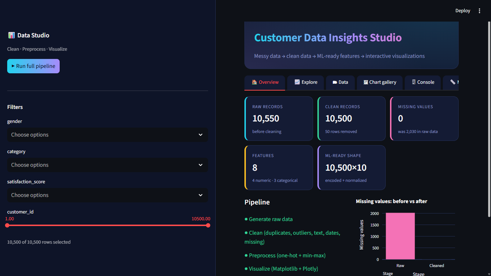
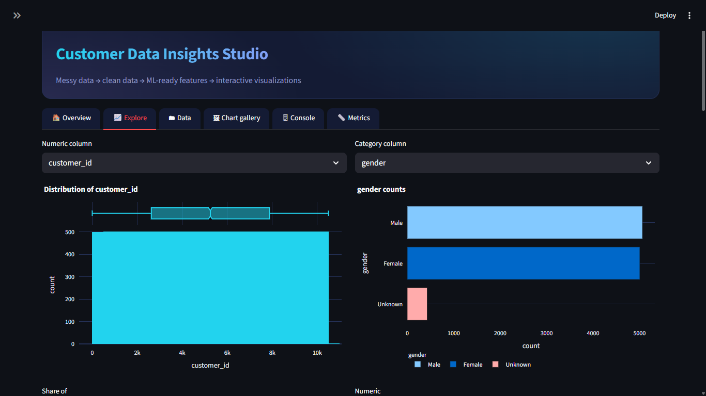
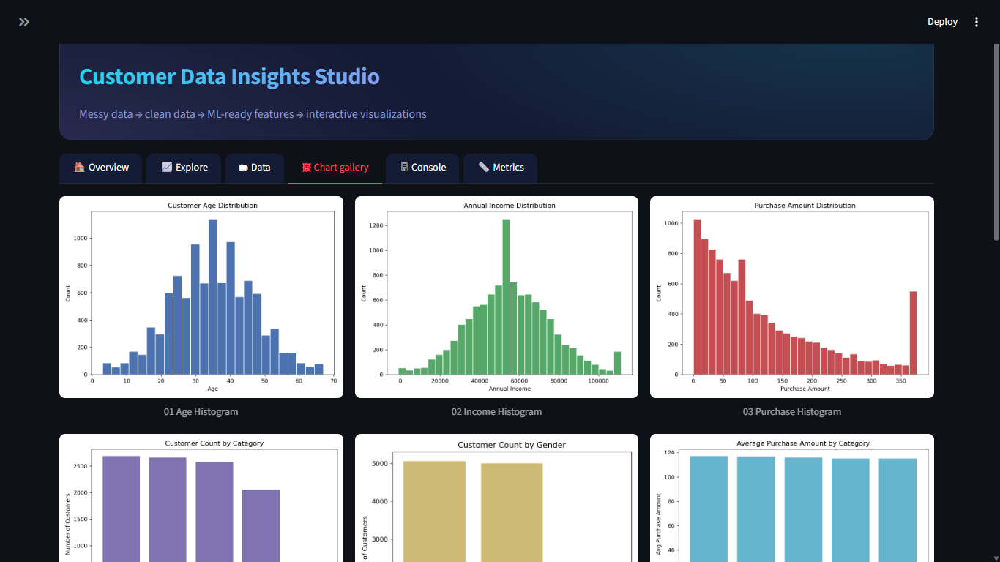
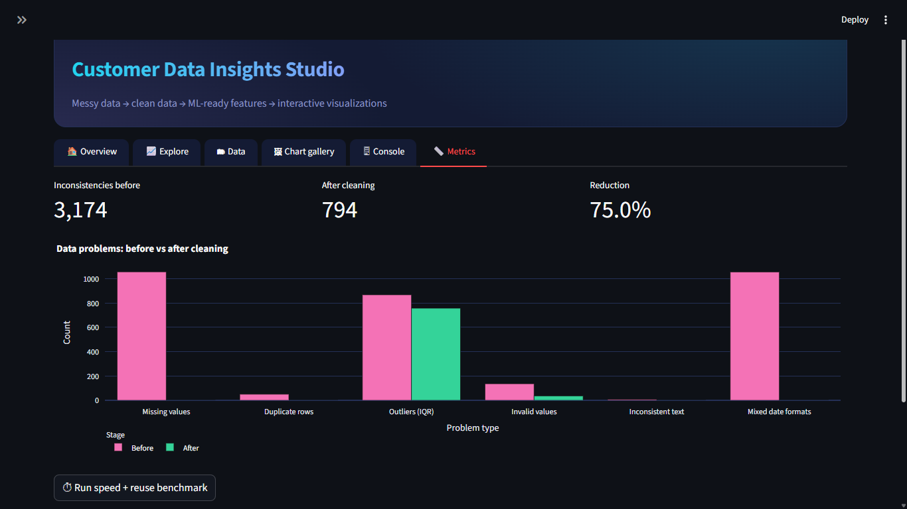

# 📊 Data Analysis & Visualization in Python

An end-to-end data project: **messy customer data → cleaning → ML-ready preprocessing → visualizations**,
with an interactive, mobile-friendly **Streamlit dashboard** and a metrics module that measures how much
the cleaning actually improved the data.

Built with **Python, Pandas, NumPy, Matplotlib, Plotly and Streamlit**.

🔗 **Live demo:** _add your Streamlit link here after deploying_

---

## ✨ Features

- **Realistic messy dataset** – 10,500+ synthetic customer records with missing values, outliers,
  inconsistent text, mixed date formats and duplicate rows.
- **Reusable cleaning module** – duplicate removal, invalid-value fixes, IQR outlier capping,
  text standardization, median imputation and date parsing.
- **ML preprocessing** – one-hot encoding for categorical features and min-max normalization for numeric features.
- **11 Matplotlib charts** – histograms, bar charts, scatter plot, correlation heatmap, boxplot and time series.
- **Interactive Streamlit dashboard**
  - dark, data-viz themed UI that works on desktop and mobile
  - KPI cards, filters, and interactive Plotly charts (distribution, category counts, share, box plot, scatter, trend, correlation heatmap)
  - data preview with CSV download, gallery of the Matplotlib charts, and a live pipeline console
- **Metrics tab** – measures data inconsistencies before vs after cleaning, cleaning speed (records/second)
  and an estimate of code-reuse savings.

---

## 🗂 Project structure

```
data_analysis_viz_project/
├── app.py                   # Streamlit dashboard (run this)
├── metrics.py               # Measures cleaning quality, speed and code reuse
├── requirements.txt
├── .streamlit/
│   └── config.toml          # Dark theme settings
├── src/
│   ├── generate_data.py     # Synthetic messy dataset generator
│   ├── cleaning.py          # Reusable cleaning functions
│   ├── preprocessing.py     # Encoding + normalization for ML
│   └── visualize.py         # 11 Matplotlib visualizations
├── data/                    # raw / cleaned / model-ready CSVs (generated)
└── outputs/                 # PNG charts and metrics report (generated)
```

`data/` and `outputs/` are created automatically when the pipeline runs.

---

## 🚀 How to run

```bash
# 1. install dependencies
pip install -r requirements.txt

# 2. launch the dashboard
python -m streamlit run app.py

# 3. (optional) measure cleaning quality and speed
python metrics.py
```

In the dashboard, click **Run full pipeline** (in the sidebar, or the button under the title on a phone).
To open it on your phone, connect both devices to the same WiFi and open the **Network URL** shown in the terminal.

---

## 🔄 Pipeline

| Step | Module | What happens |
|------|--------|--------------|
| 1. Generate | `src/generate_data.py` | Creates a raw, messy customer dataset |
| 2. Clean | `src/cleaning.py` | Removes duplicates, fixes invalid values, caps outliers, standardizes text (`"M"`, `"male"`, `"Male"` → `Male`), fills missing numbers with the median, parses mixed date formats |
| 3. Preprocess | `src/preprocessing.py` | One-hot encoding + min-max normalization → model-ready dataset |
| 4. Visualize | `src/visualize.py` | Saves 11 Matplotlib charts to `outputs/` |

### Key techniques

- **Outlier handling:** IQR-based capping, chosen over z-score trimming for interpretability and robustness to skewed distributions.
- **Missing values:** median imputation for numeric columns (robust to outliers).
- **Text standardization:** case/whitespace normalization plus explicit mapping for categorical inconsistencies.
- **ML preprocessing:** one-hot encoding for nominal categories, min-max scaling for numeric features.

---

## 📏 Measuring the results

`metrics.py` (also shown in the dashboard's **Metrics** tab) reports:

1. **Inconsistency reduction** – counts missing values, duplicates, IQR outliers, invalid values,
   inconsistent text spellings and mixed date formats in the raw vs cleaned data.
2. **Cleaning speed** – median time and records/second of `clean_dataset()`.
3. **Code-reuse estimate** – approximate lines of code for copy-pasted one-off scripts vs one reusable module.
   *This is a lines-of-code estimate, not measured time.*

The report is saved to `outputs/metrics_report.md`.

| Metric | Result |
|--------|--------|
| Data inconsistencies (before → after) | _run `python metrics.py` and fill in_ |
| Cleaning speed | _records/second from the report_ |

---

## 🖼 Screenshots

### Overview


### Interactive exploration


### Matplotlib chart gallery


### Metrics (before vs after cleaning)


### Mobile view


---

## ☁️ Deploy (free)

1. Push the project to GitHub (include `app.py`, `requirements.txt`, `.streamlit/` and `src/`).
2. Go to [share.streamlit.io](https://share.streamlit.io), sign in with GitHub and click **New app**.
3. Pick the repository, set the main file to `app.py`, and click **Deploy**.

---

## 🔮 Possible extensions

- Let users upload their own CSV/Excel file and run the pipeline on it
- Add unit tests for the cleaning functions
- Train a baseline ML model on the model-ready dataset
- Scale to larger-than-memory data with chunked reads or Dask

---

## 👤 Author

**Raghav** – MCA student, aspiring Data Analyst / Python Developer
[LinkedIn](https://www.linkedin.com/in/raghavkhatik)
