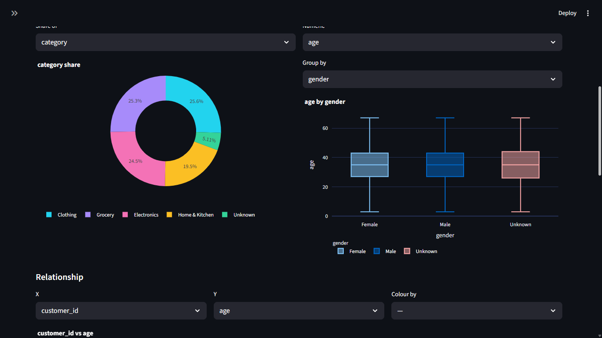
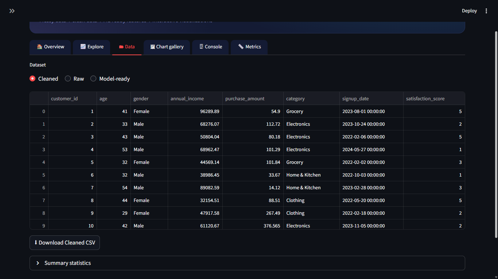
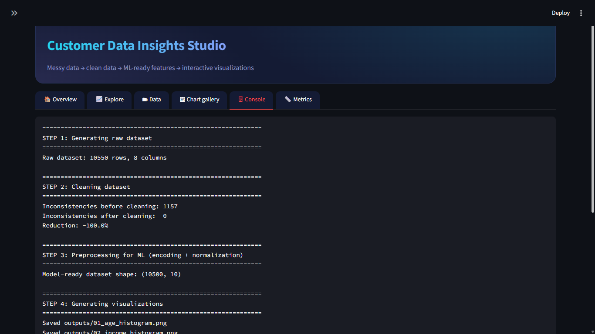

# 📊 Customer Data Insights Studio

An end-to-end **data analysis & visualization** project built with Python:
**messy customer data → cleaning → ML-ready preprocessing → visualizations**, served through an interactive,
mobile-friendly **Streamlit dashboard** with a built-in metrics tab that measures how much the cleaning improved the data.

**Tech stack:** Python · Pandas · NumPy · Matplotlib · Plotly · Streamlit

🔗 **Live demo:** [raghav-data-insights-dashboard.streamlit.app](https://raghav-data-insights-dashboard.streamlit.app/)

> Open the app and click **Run full pipeline** (in the sidebar, or under the title on a phone) to start. If the app was sleeping, press **Wake up** and wait a few seconds.

---

## 📸 Dashboard preview

### Overview
KPI cards, pipeline status and a before/after comparison of missing values, with live filters in the sidebar.


### Interactive exploration
Distribution with box plot, category counts, donut share, group-wise box plot, scatter, monthly trend and correlation heatmap.




### Data preview
Switch between raw, cleaned and model-ready data, and download any of them as CSV.



### Matplotlib chart gallery
All 11 static charts generated by the pipeline.


### Pipeline console
Live log of every pipeline step.



### Metrics: before vs after cleaning


---

## ✨ Features

- **Realistic messy dataset** – 10,550 synthetic customer records with missing values, outliers,
  inconsistent text, mixed date formats and duplicate rows.
- **Reusable cleaning module** – duplicate removal, invalid-value fixes, IQR outlier capping,
  text standardization, median imputation and date parsing.
- **ML preprocessing** – one-hot encoding for categorical features and min-max normalization for numeric features.
- **11 Matplotlib charts** – histograms, bar charts, scatter plot, correlation heatmap, boxplot and time series.
- **Interactive dashboard** – dark data-viz theme, filters, Plotly charts, CSV downloads; responsive layout that works on phones.
- **Metrics tab** – independent audit of data problems before vs after cleaning, plus a cleaning speed benchmark.

---

## 📈 Results

| Metric | Result |
|--------|--------|
| Raw records → cleaned records | 10,550 → 10,500 (50 duplicate rows removed) |
| Missing values | 2,030 → 0 |
| Data problems found by the independent audit (`metrics.py`) | 3,174 → 794 (**75% reduction**) |
| Model-ready dataset | 10,500 rows × 10 columns |

The audit counts missing values, duplicate rows, IQR outliers, invalid values, inconsistent text spellings and
mixed date formats, using a stricter definition than the cleaner's own log. The built-in cleaner reports its own
count as well (see the console screenshot). The dataset is **synthetic**, generated for this project.

**Dataset columns:** `customer_id`, `age`, `gender`, `annual_income`, `purchase_amount`, `category`,
`signup_date`, `satisfaction_score`

---

## 🗂 Project structure

```
├── app.py                   # Streamlit dashboard (run this)
├── metrics.py               # Measures cleaning quality, speed and code reuse
├── requirements.txt
├── .streamlit/
│   └── config.toml          # Dark theme settings
├── src/
│   ├── generate_data.py     # Synthetic messy dataset generator
│   ├── cleaning.py          # Reusable cleaning functions
│   ├── preprocessing.py     # Encoding + normalization for ML
│   └── visualize.py         # 11 Matplotlib visualizations
├── data/                    # raw / cleaned / model-ready CSVs (generated)
├── outputs/                 # PNG charts (generated)
└── screenshots/             # images used in this README
```

---

## 🚀 How to run

```bash
# 1. install dependencies
pip install -r requirements.txt

# 2. launch the dashboard
python -m streamlit run app.py

# 3. (optional) run the metrics report from the terminal
python metrics.py
```

In the dashboard, click **Run full pipeline** (in the sidebar, or the button under the title on a phone).
To open it on your phone, connect both devices to the same WiFi and open the **Network URL** shown in the terminal.

---

## 🔄 Pipeline

| Step | Module | What happens |
|------|--------|--------------|
| 1. Generate | `src/generate_data.py` | Creates a raw, messy customer dataset |
| 2. Clean | `src/cleaning.py` | Removes duplicates, fixes invalid values, caps outliers, standardizes text (`"M"`, `"male"`, `"Male"` → `Male`), fills missing numbers with the median, parses mixed date formats |
| 3. Preprocess | `src/preprocessing.py` | One-hot encoding + min-max normalization → model-ready dataset |
| 4. Visualize | `src/visualize.py` | Saves 11 Matplotlib charts to `outputs/` |

### Key techniques

- **Outlier handling:** IQR-based capping, chosen over z-score trimming for interpretability and robustness to skewed distributions.
- **Missing values:** median imputation for numeric columns (robust to outliers).
- **Text standardization:** case/whitespace normalization plus explicit mapping for categorical inconsistencies.
- **ML preprocessing:** one-hot encoding for nominal categories, min-max scaling for numeric features.

---

## ☁️ Deploy (free)

1. Push the project to GitHub (include `app.py`, `requirements.txt`, `.streamlit/` and `src/`).
2. Go to [share.streamlit.io](https://share.streamlit.io), sign in with GitHub and click **New app**.
3. Pick the repository, set the main file to `app.py`, and click **Deploy**.

---

## 🔮 Possible extensions

- Let users upload their own CSV/Excel file and run the pipeline on it
- Add unit tests for the cleaning functions
- Train a baseline ML model on the model-ready dataset
- Scale to larger-than-memory data with chunked reads or Dask

---

## 👤 Author

**Raghav** – MCA student, aspiring Data Analyst / Python Developer
[LinkedIn](https://www.linkedin.com/in/raghavkhatik)
